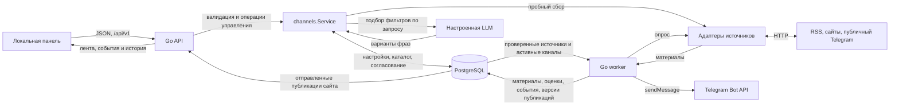

# Архитектура и потоки данных

## Узлы и их границы

| Узел | Вход | Что делает | Выход |
| --- | --- | --- | --- |
| Панель управления | Действия оператора и JSON API | Показывает источники, каналы, пресеты, историю, согласование и ленту сайта | Запросы API и предпросмотр данных |
| HTTP API | Запросы панели и других локальных клиентов | Проверяет JSON, ID и параметры списков, вызывает операции управления, преобразует ошибки в HTTP-ответы | JSON клиенту, запросы к сервису управления |
| Сервис управления | Данные из формы или API | Нормализует настройки и источники, сохраняет ресурсы, запускает пробный сбор или подбор фильтров | Записи PostgreSQL либо результат для формы |
| HTTP-клиент и адаптеры | URL источника, его тип и метаданные | Загружают открытый ответ и извлекают заголовок, ссылку, текст, дату и внешний ID | Нормализованные материалы для worker или пробного сбора |
| Worker | Активные каналы, проверенные источники, время и состояние базы | Планирует опрос, запускает оценку по каждому каналу, обрабатывает очередь | Материалы и карточки в базе, попытки доставки на площадки |
| Правила обработки новостей | Материал, источник, настройки одного канала и недавние карточки | Определяют соответствие теме, связывают материал с событием и рассчитывают приоритет | Решение для транзакции PostgreSQL |
| PostgreSQL | Запросы API и worker | Хранит каталог, настройки, общий набор материалов, отдельные карточки каналов и историю доставки | Источник состояния для управления, обработки и выдачи ленты |
| Доставка | Подготовленная версия, площадка и настройки выпуска | В Telegram отправляет сообщение, для сайта делает версию доступной через запись в базе | Статус, время публикации и ID сообщения при наличии |
| Необязательная LLM | Тема, аудитория и текст исключений из формы | По запросу оператора предлагает ключевые слова и стоп-фразы | Предложения в форме, которые оператор сохраняет как обычные настройки |

## Путь одного материала

1. Оператор добавляет источник через панель. API передаёт URL и тип в сервис управления, тот проверяет их и сохраняет запись в `sources`. Пробный сбор возвращает предпросмотр. Регулярный опрос начинается после установки статуса `verified` при наличии включённого канала.
2. Worker передаёт источник нужному адаптеру. Адаптер извлекает материал, worker добавляет время загрузки и сохраняет версию в `materials`. Повтор той же версии от того же источника пропускается.
3. Worker читает материал и настройки каждого активного канала. Для каждого канала отдельно он передаёт их модулю правил и сохраняет результат в `material_evaluations`.
4. При новом событии или существенном обновлении та же транзакция обновляет карточку `events` и создаёт строки `publications`. Один материал может получить разные решения, карточки и приоритеты в разных каналах. Публикации сайта и Telegram имеют отдельные записи.
5. Когда выполнены условия выпуска, worker берёт запись из очереди. Для сайта состояние `sent` открывает эту запись в API ленты. Для Telegram worker отправляет сообщение и сохраняет результат Bot API.

## Развёртывание

Compose запускает Go API, Go worker, PostgreSQL и приватный S3-сервис SeaweedFS. Медиафайлы и временные загрузки находятся на D:, служебные базы SeaweedFS — в отдельных томах Docker. [Поток медиа](media.md). Один образ бэкенда содержит два исполняемых файла. API обслуживает встроенную панель по `/` и JSON по `/api`. Worker работает как отдельный процесс. Оба подключаются к одной базе и применяют миграции на старте. Контейнер интеграционных тестов запускается через отдельный профиль. [Локальный запуск](backend-local.md)

Текущий сбор работает по настроенному каталогу. Веб-поиск, глобальный поиск по Telegram, браузерная загрузка страниц, управление входящими командами Telegram, аккаунты и отдельный интерфейс Next.js пока остаются за границами реализации.

## Проверка темы перед обработкой события
Worker проверяет материал по профилю канала до запроса карточек событий. Короткие неоднозначные записи RSS могут отправиться в фоновую очередь дочитывания PostgreSQL. При включённых моделях worker сравнивает по смыслу или запрашивает объяснение с цитатой. История решений доступна через HTTP API. [Схема потока](topic-classification.md)
