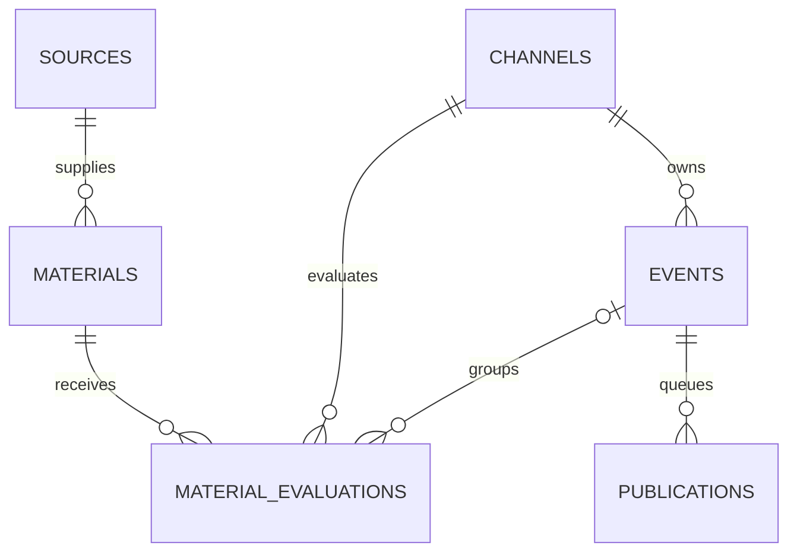

# PostgreSQL и связи данных

## Модель хранения

| Таблица | Что сохраняет | Ключ и область действия |
| --- | --- | --- |
| `sources` | Имя, организацию, тип, URL, темы, статус, признак первоисточника, время успешного опроса и последнюю ошибку | Первичный ключ `id`, уникальная пара `kind, url`. Каталог общий. |
| `channels` | Имя, активность, сайт, Telegram-чат и правила в JSONB `settings` | Первичный ключ `id`, уникальное имя. Одна запись соответствует одной ленте. |
| `presets` | Имя и шаблон правил в JSONB | Первичный ключ `id`, уникальное имя. Настройки копируются в канал при применении. |
| `materials` | Идентификатор источника, внешний ID, URL, заголовок, текст, время публикации и получения, снимок организации и признака первоисточника | Первичный ключ `id`. Дубликат определяется по `source_id, external_id, content_hash`. Общий набор для всех каналов. |
| `events` | Заголовок, резюме, факты в JSONB, версию и время первой и последней записи | `id`, `channel_id`. Карточка принадлежит одному каналу. |
| `material_evaluations` | Итог оценки, причину, время и необязательную ссылку на связанное событие | `channel_id, material_id`. Для отклонения `event_id` пуст. Связь с событием проверяется вместе с ID канала. |
| `publications` | Снимок версии для сайта или чата, срочность, приоритет, состояние, время, решение согласования, внешний ID и диагностику | Первичный ключ `id`, уникальный набор `event_id, target, destination, version`. Сайту соответствует пустой `destination`. |
| `schema_migrations` | Имена применённых SQL-миграций и время их применения | Проверяется при запуске и запросе готовности |

`content_hash` — SHA-256 от URL, заголовка и тела. При новом тексте у того же внешнего ID появится новая строка материала. Время опроса и дата публикации не входят в хеш. Повторное получение той же версии сохраняет первую запись.

## Кто читает и пишет

- API читает и изменяет каталог, каналы и пресеты. API читает карточки и статусы публикаций, а решение согласования записывает в очередь.
- Worker читает актуальные статусы источников и каналов. Он пишет материалы, результаты опросов, оценки, карточки и статусы доставки.
- Модуль `news` получает данные от worker и возвращает решение в памяти. Записью занимается слой PostgreSQL.
- Лента сайта читает строки со статусом `sent` для площадки `website`. ID события и номер версии доступны в её JSON.

## Как обеспечивается согласованность

Цикл worker захватывает консультативную блокировку на соединении для текущей схемы. Другой worker с той же схемой пропустит цикл, если блокировка занята. Этап оценки открывает транзакцию, блокирует строку канала, сверяет настройки и статус источника, затем сохраняет оценку, обновление карточки и новые публикации. Если в процессе настройки изменились, запись оценки откладывается до следующей обработки. Версия карточки проверяется при обновлении.

Захват записи очереди использует блокировку строки с `SKIP LOCKED`. Внешняя отправка происходит после сохранения `sending`, а результат обновляется отдельным запросом. Сбой между отправкой и записью результата поэтому проявится как `uncertain` для Telegram. [Правила доставки](publishing.md)

## Миграции

`001_catalog.sql` создаёт источники, каналы, пресеты, материалы, события и оценки. `002_publications.sql` добавляет очередь и индексы для публикации, согласования и выдачи ленты. `003_review_decisions.sql` добавляет сохранённое решение по согласованию.

Оба Go-процесса вызывают один раннер при запуске. Он применяет встроенные SQL-файлы в порядке имён в транзакции с блокировкой текущей схемы. Уже применённые имена пропускаются. PostgreSQL-том Compose сохраняется при обычной остановке стенда.

[SQL-миграции](../backend/migrations) · [Транзакция оценки](../backend/internal/postgres/news.go) · [Очередь](../backend/internal/postgres/publications.go)

## Вложения, этап 2

Миграция 004_media.sql добавляет materials.media и publications.media типа jsonb с ограничением на массив и значением по умолчанию []. Элемент содержит url и kind (photo/video). Исходные ссылки сохраняются при сборе, снимок копируется при создании версии публикации. Прежние строки получают пустой массив. [Путь медиа](media.md).

## Определение тематики
Миграция 005 добавляет nullable topic_decision в material_evaluations и индекс истории по каналу и времени. В topic_decision сохраняются исход, метод, основание, совпадение, версия настроек и необязательный балл. Для старых оценок поле пустое.
material_articles хранит состояние очереди, попытки, срок действия, текст, начало статьи и вложения. Первичный ключ material_id ссылается на materials и объединяет запросы всех каналов к одной версии.
topic_embeddings кеширует массивы real по паре «провайдер и модель» и SHA-256 входного текста. topic_reviews хранит последний исторический прогон и оценку редактора по составному ключу material_evaluations. [Подробности](topic-classification.md)
