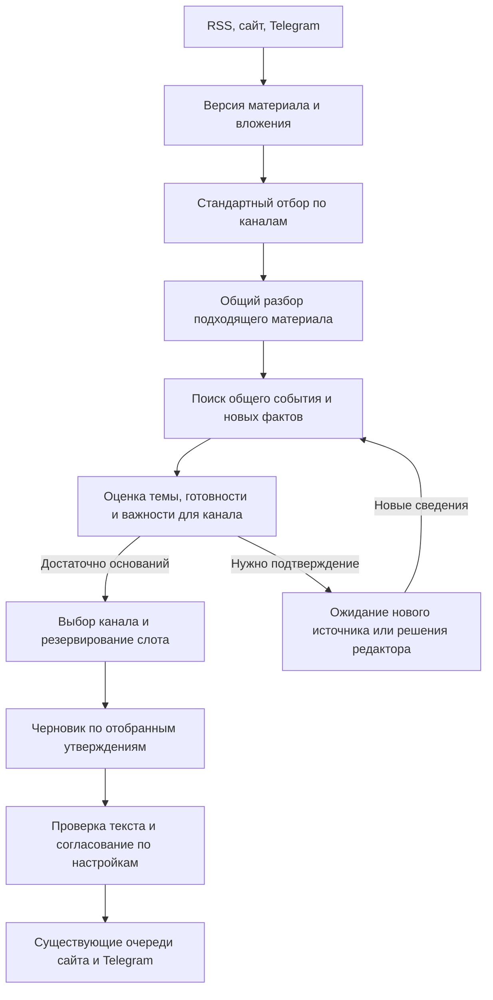

# Проект редакционной обработки новостей

**Статус — общий каталог реализован в теневом режиме.** Действующее сопоставление и архивный запуск описаны в [документации каталога](event-catalog.md). Ниже описана целевая система редакционной обработки. Первый канал для проверки — смм1. За единицу отбора принимается событие. Один материал может добавить к нему сведения, одна версия события может попасть в очередь конкретного канала, а у одного поста могут быть две доставки — на сайт и в Telegram.

## Где меняется действующий поток

Сегодня worker оценивает пару «материал × канал», ищет похожие карточки внутри этого канала и одной транзакцией сохраняет оценку, карточку и публикации. Поэтому два пересказа одного судебного решения с разными заголовками могут получить разные карточки и занять два слота. Предлагается сохранить сбор, PostgreSQL, Go worker, S3 и способы доставки. Между сбором и существующей очередью публикаций появятся общий каталог событий и выбор события на ближайший выпуск. [Текущий процесс](news-pipeline.md) · [Транзакция обработки](../backend/internal/postgres/news.go)

## От документа до события

1. **Сбор и первичный отбор.** Сохранить исходную версию, дату, автора сообщения, URL и медиа. При новом сборе сохранять также абзацы и назначения ссылок рядом с видимым текстом. Сейчас нормализация сворачивает пробелы и переносы строк. Для старых записей использовать сохранённый текст. Проверять источник, свежесть и стоп-темы каждого канала по исходнику; после дочитывания RSS повторить проверку по полному тексту. Точный ключ, русские словоформы и векторное сходство дают кандидатов. Контекстное совпадение или нехватка текста ведут к дочитыванию либо дополнительной оценке. Канал, запретивший исходный материал, исключается из дальнейшего отбора этого материала. [Сбор](ingestion.md) · [Проверка темы](topic-classification.md)
2. **Редакционный разбор.** Если хотя бы одному каналу материал подходит для дальнейшей проверки, обрабатывать его один раз. Короткий пост передавать LLM целиком, длинный текст — пронумерованными абзацами с заголовком и соседним контекстом. Выход — главная тема, участники, действие, место, время, стадия события и утверждения. Каждое утверждение содержит дословную опору в исходнике, автора сообщения и степень определённости. Фрагмент может одновременно содержать факт и атрибуцию. Векторы помогают подобрать размеченные примеры. Приглашения подписаться исключаются из черновика; ссылка на документ, источник цитаты и оговорка «может» сохраняются. Go сверяет ссылки на фрагменты с сохранённой версией. Дайджест с несколькими независимыми событиями разбивается на отдельные утверждения с привязкой к соответствующим сюжетам.
3. **Сопоставление событий.** Искать ближайшие ранее известные сюжеты по векторам фактов, участникам, датам и ссылкам на документы. Стартовая настройка для проверки — 10 ближайших за 72 часа плюс поиск по точному идентификатору документа и незавершённым событиям за пределами окна. Затем сверять участника, действие, объект, место, время и стадию с самой карточкой. ТАСС и RT об одном решении суда BSW дают одно событие. Первое и окончательное чтения одного проекта дают две версии. Похожие запреты в разных регионах дают разные события. Неоднозначную пару оценивает LLM по исходным фрагментам; нерешённый конфликт уходит редактору.
4. **Версии и доказательства.** Пересказ добавляет ссылку к событию. Существенный новый факт, официальное подтверждение, исправление или опровержение создают версию с перечислением изменений. Хранить отдельно происхождение каждого утверждения: три СМИ, сославшиеся на одно сообщение, представляют одну цепочку происхождения. Для каждого канала разрешать в черновике только утверждения с допустимой для этого канала опорой. Проверку первоисточника для конкретных условий и документов сохранить. Количество сообщений учитывается как распространённость сюжета; оно само по себе не доказывает утверждение.

## От события до слота

Для версии события LLM описывает, что изменилось, кого затрагивает, когда проявятся последствия, какие сведения подтверждены и что нового относительно предыдущей версии. Для каждой пары «версия × профиль канала» возвращает тематический вердикт, уровень важности (высокий, обычный, низкий), причину и ссылки на утверждения. Go применяет редакционные исключения, доступность доказательств и сроки. **Срочность проверки хранится отдельно от готовности к выпуску.** В очереди проверки может первым стоять событие, для которого ещё рано составлять заголовок.

Для смм1 действует [решение редактора](smm1-editorial.md). Наивысший приоритет среди готовых материалов получают значимые события, связанные с СВО, с подтверждёнными последствиями для людей или инфраструктуры. Если подтверждено лишь перекрытие моста, выпуск может сообщить о перекрытии. Сообщение о разрушении остаётся на проверке. Его последующее подтверждение даст основание для обновления. Переключатель «Необычные истории и рекорды» по умолчанию выключен.

Планировщик рассматривает ближайшие слоты совместно для каналов одной настроенной группы. Сначала отбирает свежие, тематически подходящие и готовые события. В каждом канале сортирует по редакционному приоритету, затем по существенной новизне, свежести и стабильному ID. Группу образует редактор; отдельный канал по умолчанию образует собственную группу. Если у канала А есть два равноценных кандидата, а у Б подходит только один из них, общий кандидат достаётся Б. При прочих равных очередь выбора между каналами чередуется.

Внутри группы одну версию события резервировать за одним каналом, учитывая и запланированные, и отправленные посты. Обновления по возможности присоединять к предыдущему выпуску того же канала. При нехватке материала допускать пустой слот. Паузы 10–25 минут, тихие часы, срок годности и согласование смм1 продолжают действовать. Зарезервированный, но ещё не отправленный низкоприоритетный материал можно заменить перед выпуском, если появилась более важная готовая версия. Отправку, которая уже началась, завершает действующий модуль доставки. [Окна и состояния доставки](publishing.md)

## Черновик и проверка

После выбора канала LLM получает его стиль, список разрешённых утверждений и опорные фрагменты. Возвращает заголовок, абзацы и ссылки от каждого предложения к утверждениям. Числа, имена, даты, цитаты и стадию решения проверять по исходнику; отдельно сверять отрицания и атрибуцию. Например, «депутаты приняли во втором чтении» не даёт основания написать «запрет вступил в силу». Если проверка расходится с черновиком, разрешить одну повторную генерацию, затем направить на согласование с причиной. Публикация получает один проверенный текст, источник и отобранные вложения. Действующий адаптер оформляет Telegram-подпись и загружает медиа через S3.

## Хранение и выполнение в Go

Ниже предложена логическая схема для PostgreSQL. Имена обозначают будущие сущности. Привязанные к каналу `events` временно остаются представлением для существующего API, истории и доставки.

| Данные | Ключ и назначение |
| --- | --- |
| Разбор материала | Версия материала + хеш фактически прочитанного текста + версия модели и инструкции. Включает утверждения и ссылки на фрагменты. Дочитанная статья получает собственный результат. |
| Общие события, версии и источники | ID события и номер версии. Таблица связей соединяет утверждения разных материалов с событием. Новая ссылка на уже известный факт сохраняется без создания новой версии для публикации. |
| Оценка канала | Версия события + канал + версия профиля и правил. Содержит приоритет проверки, готовность, важность, основания и срок годности. Изменение профиля пересчитывает ещё актуальных кандидатов. |
| Назначение и черновик | Уникальное действующее назначение для группы и версии события; одновременно один владелец слота канала. Хранит версию стиля, результат проверки текста и связь с записями доставки. Отправленное назначение продолжает защищать от повторов. |
| Фоновые задания | Вид операции, версия входа, состояние, следующая попытка, владелец и срок захвата. Уникальность операции с тем же входом делает повторный запуск идемпотентным. |

Оркестрация остаётся в Go. Адаптеры `ingest` собирают вход, `topic` выполняет дешёвый отбор и обращение к моделям, `news` сопоставляет события, `postgres` отвечает за транзакции. Редакционный разбор и проверку черновиков предлагается выделить в `internal/editorial`, назначение каналам — в планировщик worker. Вызовы моделей выполнять отдельным ограниченным пулом, вне транзакций и основного цикла доставки. Для первой версии достаточно PostgreSQL, существующего кеша эмбеддингов и сравнения ограниченного пула кандидатов в Go. Переход к индексированному векторному поиску оценить по задержке и доле пропущенных пар.

Для первой реализации сериализовать присоединение разобранных материалов к общим событиям; повторно сверять актуальную версию перед записью. При выборе слота короткая транзакция блокирует группу, сверяет профиль, срок годности и существующие назначения. Новая версия, пришедшая во время генерации, делает черновик устаревшим. Проверка перед передачей в доставку фиксирует назначение, снимок канальной карточки и строки публикаций в одной транзакции. Повтор задания возвращает прежний результат. При сбое провайдера — ограниченные повторы с задержкой до истечения срока новости; при длительной недоступности — ручная оценка. Готовые ранее проверенные публикации доставляются по расписанию. Неопределённый исход отправки в Telegram сохраняет существующий статус `uncertain` и блокирует автоматический повтор.

## Панель, внедрение и проверка

В панели редактору нужны три представления: событие с источниками и отличиями версий; очередь канала с причинами выбора или ожидания; один пост с отдельными статусами сайта и Telegram. Для спорных случаев предусмотреть подтверждение факта с источником, разделение ошибочно объединённых событий и отклонение черновика. Действующие маршруты описаны в [руководстве управления](management.md); новые поля и операции должны войти в OpenAPI при реализации.

1. **Сначала общие события и повторы.** На сохранённых данных построить группы параллельно действующему worker. Проверить, что пересказы BSW дают один слот, разные регионы не склеиваются, а новая стадия закона остаётся видимой. Это первый самостоятельно проверяемый результат.
2. **Потом редакционный отбор.** Проиграть 18 ноября по Москве в порядке поступления материалов, открывая системе только сведения, доступные к очередному слоту. Сравнить с фактическими отправками, отдельно считать материалы, пришедшие после последней отправки. Проверить порядок подтверждённое событие о мосте → № 7 → № 13 → № 3 и исключение рекорда при выключенном переключателе. Использовать следующую размеченную дату как независимую проверку.
3. **Две ленты и черновики.** Смоделировать два канала одной темы, потерю провайдера, повтор задания и одновременное резервирование. Критерии приёмки на контрольной выборке — ноль повторных назначений одной версии в группе, ноль отправок неподтверждённых утверждений как фактов, сохранение обязательной атрибуции и стадии решения. Для оценки качества показать редактору пропущенные важные события, ошибочные склейки, совпадения с его десяткой, пустые слоты, задержку до выпуска и число модельных вызовов на опубликованный пост.
4. **Переключить один канал.** Режимы по каналу: действующий, теневой, редакционный. В теневом режиме запрещено создавать записи доставки. Перед переключением сверить свежие отправленные и ожидающие карточки с общими событиями; спорные совпадения оставить на проверке. Задать границу по времени и единственного владельца новых постановок в очередь. Для возврата завершить или снять ещё не отправленные назначения, сохранить историю отправок и исключить их из повторного выпуска. Затем применять новую схему к группе каналов.
