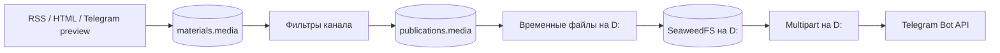

# Медиа и оформление Telegram

Worker сохраняет ссылки на оригиналы в PostgreSQL. При выпуске принятой новости он скачивает вложения на D:, загружает в приватный S3 bucket, читает обратно из S3 и отправляет байты в Telegram.



## Извлечение

RSS и Atom читают image/video enclosure и Media RSS content/group. HTML использует Open Graph и изображения внутри article. Видео извлекается из video/src и вложенных source, og:video принимается для прямой MP4-ссылки. Telegram preview использует photo_wrap/background-image и video/src. При наличии видео изображения предпросмотра исключаются. Сохраняется до 10 уникальных вложений. JS-плееры, HLS, закрытые вложения и архив Telegram требуют отдельного адаптера.

Массивы объектов с полями url и kind (photo или video) находятся в materials.media и копируются в publications.media. Миграция 004 задаёт пустой массив для прежних строк. При повторном опросе пустой список вложений прежнего материала дополняется найденными ссылками. Уже обработанные новости автоматически повторно не выпускаются. Формат API панели сохраняется, вложения использует адаптер Telegram.

## Хранилище

SeaweedFS 4.52 работает контейнером media в сети Compose. D:/smm-agent-media/objects привязан к /data, D:/smm-agent-media/uploads — к /media-upload у worker. Оригиналы находятся на D:. Служебные базы master и filer вынесены в Docker-тома media-master, media-filer и media-control из-за отказа rename на Windows bind mount. Для восстановления сохраняйте все три тома вместе с objects. SMM_MEDIA_DIR меняет корневой каталог. Каталоги создаются заранее, Compose проверяет наличие. S3 не публикует порт на хост.

S3_ENDPOINT=http://media:8333, S3_BUCKET=news-media. Случайные S3_ACCESS_KEY и S3_SECRET_KEY находятся в локальном .env. SeaweedFS получает их как AWS_ACCESS_KEY_ID и AWS_SECRET_ACCESS_KEY. MEDIA_TEMP_DIR задаёт worker каталог временных файлов. При нативном запуске переменные задаются явно.

Ключ news/SHA256 вычисляется из типа и URL оригинала. Повторная доставка читает уже сохранённый объект. Это фиксирует первую загруженную версию файла по данному URL. Данные сохраняются между перезапусками, автоматической очистки bucket пока нет.

Фото ограничены 10 МиБ и JPEG/PNG, видео — 50 МиБ и MP4. Проверяются начальные байты, публичные IP, редиректы, таймауты и размер ответа. Файлы обрабатываются через диск. Исходник и multipart-запрос удаляются после завершения операции. После аварийного завершения процесса временные файлы могут остаться в uploads.

## Telegram

Один файл отправляется через sendPhoto/sendVideo, несколько — sendMediaGroup. Подпись находится у первого элемента альбома. Заголовок жирный, текст курсивный. Затем идут ссылка на источник и через пустую строку имя канала со ссылкой и словом «Подписаться». getChat уточняет настоящее название и username. Для закрытого канала используется доступная invite_link, при её отсутствии выводится имя. Если getChat недоступен, используется имя из настроек.

Текст экранируется для HTML. Сообщение ограничено 4096 единицами UTF-16, подпись медиа — 1024. Длинные заголовок и текст сокращаются с сохранением подписи канала. Без вложений вызывается sendMessage.

Ошибка загрузки, S3 или явный отказ Telegram переводят запись в failed с причиной. При неопределённом результате отправки используется uncertain. Автоматического повтора этих состояний пока нет. ID первого сообщения альбома сохраняется для цепочки дополнений.

## Проверка

```powershell
docker compose up -d media
docker compose --profile test run --build --rm integration
docker compose logs --tail=100 media worker
```

Интеграционный тест загружает синтетический файл в настоящий S3, читает обратно и проверяет повторное чтение. Тест Telegram проверяет multipart и альбом на имитации API.
