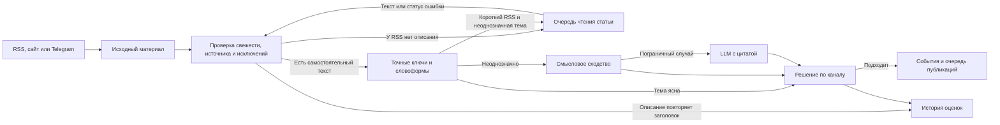

# Определение тематики

Worker принимает решение для пары «материал и канал» до загрузки карточек событий. Затем для подходящего материала действует обычный процесс поиска дублей, проверки первоисточника и подготовки публикации.



## Профиль канала

В «Каналы → Изменить» укажи тему, однозначные ключи и стоп-фразы. Расширенный профиль принимает описание, подтемы с ключами, контекстные слова и положительные и отрицательные примеры. Например, `Госдума` может быть ключом подтемы «Работа парламента», а `президент` — контекстным словом. Контекстное слово всегда требует дополнительного основания, даже если оно продублировано среди обычных ключей. Исключения проверяются как точные нормализованные фразы. Пресеты поддерживают те же поля.

Кнопка «Подобрать фильтры с ИИ» использует настройки `LLM_FILTERS_*` и заполняет черновик ключей и тематического профиля. Сохранение формы применяет черновик. Модели для обработки новостей включаются отдельно.

## Правила обработки

1. Worker проверяет источник, заголовок, ссылку, свежесть и стоп-фразы. Полнотекстовый поиск PostgreSQL с конфигурацией `russian` сопоставляет словоформы и фразы отдельно в заголовке, начале текста и остальном тексте. Точные совпадения поддерживают имена и сокращения. Сильный ключ в заголовке или начале даёт решение «По теме». Упоминание только в остальном тексте или контекстный ключ требуют дополнительных оснований.
2. Перед подбором ключей worker удаляет конечную подпись «Читать далее» и отклоняет описание, которое повторяет заголовок. Дочитывание доступно для RSS без описания либо для короткого описания (менее 80 нормализованных символов) с неоднозначной темой. Фоновый обработчик читает страницу через существующий HTTP-клиент и HTML-парсер. Он проверяет соответствие заголовку RSS и может использовать исходную дату, когда у статьи нет своей. Текст ограничен 12 000 символами. В БД дополнительно сохраняется начало статьи для проверки темы и ссылки на найденные вложения. Повторная оценка проверяет стоп-фразы в обоих текстах, после чего полный текст участвует и в обработке события.
3. Для одного материала все каналы используют одну запись дочитывания. На каждую попытку отводится до 15 секунд, при ошибке есть одна повторная попытка. Захват с 45-секундной арендой позволяет завершать или повторять задания после перезапуска. Изменение текста RSS создаёт другую версию материала и позволяет прочитать её отдельно. Пока задание активно, оценка материала ждёт его завершения. При ошибке используется RSS. Короткий текст без сильного совпадения даёт «Нужен контекст».
4. Параметры `use_vectors` и `use_llm` по умолчанию включены, в том числе для канала без отдельного профиля. Их можно выключить кнопкой «LLM и векторы» в строке канала. Worker использует только настроенные провайдеры. Если обе проверки выключены или провайдеры отсутствуют, материал с достаточным текстом и без совпадений получает «Вне темы», а слабое совпадение остаётся в состоянии «Нужен контекст».

## Векторы и LLM

`TOPIC_EMBEDDINGS_URL`, `TOPIC_EMBEDDINGS_MODEL` и необязательный `TOPIC_EMBEDDINGS_API_KEY` настраивают совместимый HTTP-метод эмбеддингов с массивом `input` и ответом `data[].embedding`. Для имён моделей с `e5` добавляются префиксы `passage:` к новости и `query:` к эталонам. Кеш в PostgreSQL использует имя метода и модели вместе с SHA-256 входа. Один вектор новости переиспользуется между каналами. Go вычисляет косинусное сходство с подтемами и примерами.

Включи векторы в профиле, чтобы получить балл. Без заданных порогов он доступен для сравнения и передачи в LLM. `vector_accept` задаёт минимальный балл по подтеме для автоматического принятия. `vector_reject` задаёт максимальный балл для отклонения материала без совпавших ключей. Близость к отрицательному примеру оставляет случай пограничным. Пороги подбираются по редакторским оценкам.

`TOPIC_LLM_URL`, `TOPIC_LLM_MODEL` и необязательный `TOPIC_LLM_API_KEY` подключают совместимый Chat Completions API с JSON-ответом. В запрос входят описание канала, заголовок и ограниченный фрагмент статьи. Принятие или отклонение требует цитаты, которая буквально есть в переданном тексте. При недоступности провайдера, выходе за лимит или некорректном ответе материал получает «Нужен контекст». На процесс действует лимит 60 запросов эмбеддингов и 10 запросов LLM за минуту. Пакет недостающих векторов для одной оценки считается одним запросом.

Для проверки локального стенда достаточно ключей и дочитывания. Чтобы включить вызовы моделей, настрой провайдеры в `.env` и пересоздай контейнеры API и worker. Внешнему провайдеру передаются заголовок и фрагмент статьи, а также необходимые для оценки части редакционного профиля.

## Локальная LLM в Compose

Профиль `llm-local` запускает llama.cpp с Qwen3 4B Instruct 2507 в формате GGUF Q4_K_M. Сервис доступен другим контейнерам как `http://llm:8080/v1/chat/completions`. На хост порт не публикуется.

Сохраните веса из публичного [реестра Ollama](https://ollama.com/library/qwen3:4b-instruct-2507-q4_K_M) в `D:/smm-agent-models/qwen3-4b-instruct-q4_k_m.gguf`. Сверьте SHA-256 `85e4a5b7b8ef0e48af0e8658f5aaab9c2324c76c1641493f4d1e25fce54b18b9`. Для другого каталога задайте `SMM_LLM_DIR`.

В `.env` задайте параметры двух существующих клиентов:

```dotenv
TOPIC_LLM_URL=http://llm:8080/v1/chat/completions
TOPIC_LLM_MODEL=qwen3-4b-instruct
LLM_FILTERS_URL=http://llm:8080/v1/chat/completions
LLM_FILTERS_MODEL=qwen3-4b-instruct
```

Запустите провайдер командой `docker compose --profile llm-local up -d llm`. Когда журнал `docker compose --profile llm-local logs --tail=30 llm` покажет готовность, примените настройки клиентов командой `docker compose --profile llm-local up -d api worker`. Для диагностики смотрите метод и причину решения в «Каналы → Проверка темы».

### NVIDIA CUDA в Docker Desktop

На стенде с RTX 3070 используйте [дополнение Compose](../compose.llm-cuda.yaml). Оно выполняет официальную Linux-сборку llama.cpp b12208 с CUDA 12.8. Базовый образ предоставляет системные библиотеки. CUDA-бинарники и веса читаются с диска D. Для Docker Desktop нужен Linux-бэкенд с доступом к NVIDIA GPU.

Из [релиза b12208](https://github.com/ggml-org/llama.cpp/releases/tag/b12208) скачайте два архива и распакуйте каждый в свою папку внутри `SMM_LLM_DIR/cuda-b12208`:

| Архив | Папка распаковки | SHA-256 |
| --- | --- | --- |
| `llama-b12208-bin-ubuntu-cuda-12.8-x64.tar.gz` | `server` | `be560d1ba7f73e056502d01b6a2701d8d1bb9ca7369c3140a0270f3f07c94436` |
| `cudart-llama-b12208-bin-ubuntu-cuda-12.8-x64.tar.gz` | `libraries` | `77fe809b3c4c1f35b43f4ce460b10280a9e6ae155f85fc2c82b1debbd0e51688` |

В первой папке нужен `llama-b12208/llama-server`, во второй — `cudart-llama-b12208-bin-ubuntu-cuda-12.8-x64/libcudart.so.12`. При распаковке Windows может пропустить Linux-симлинки к библиотекам. Контейнер создаёт нужные ссылки во временной файловой системе при запуске.

```powershell
docker compose -f compose.yaml -f compose.llm-cuda.yaml --profile llm-local up -d llm api worker
```

Для последующих запусков всех сервисов используйте те же два файла Compose, чтобы сохранить конфигурацию GPU. При запросе оценки worker по-прежнему применяет свой тайм-аут и проверяет цитату. В архивной проверке результат с методом `llm` подтверждает, что ответ модели прошёл проверку.

На Windows файлы и профиль можно закрепить в локальном `.env` через `COMPOSE_FILE=compose.yaml;compose.llm-cuda.yaml` и `COMPOSE_PROFILES=llm-local`. Тогда обычный `docker compose up -d` использует GPU-профиль.

## История оценок

«Каналы → Проверка темы» показывает последнее рабочее решение, сохранённую повторную оценку и метку редактора. «Переоценить» применяет текущий профиль к сохранённому тексту. Если статья уже была дочитана, используется также её текст. Исторический просмотр проверяет тему и стоп-фразы независимо от возраста новости. Повторные оценки и редакторские метки хранятся отдельно от рабочего решения и очереди выпуска.

Для сравнения разметь дополнительные совпадения по словоформам, выборку остальных отказов и ранее принятые материалы. Сравни число подходящих уникальных событий, число лишних совпадений и объём ручной проверки. Примеры одного события держи вместе при разделении материалов на подбор порогов и итоговую проверку.
