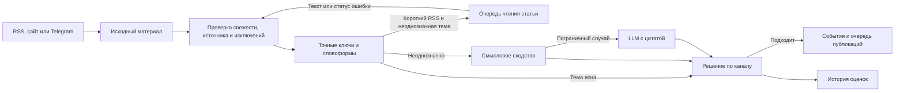

# Определение тематики

Worker принимает решение для пары «материал и канал» до загрузки карточек событий. Затем для подходящего материала действует обычный процесс поиска дублей, проверки первоисточника и подготовки публикации.

## Профиль канала

В «Каналы → Изменить» укажи тему, однозначные ключи и стоп-фразы. Расширенный профиль принимает описание, подтемы с ключами, контекстные слова и положительные и отрицательные примеры. Например, `Госдума` может быть ключом подтемы «Работа парламента», а `президент` — контекстным словом. Контекстное слово всегда требует дополнительного основания, даже если оно продублировано среди обычных ключей. Исключения проверяются как точные нормализованные фразы. Пресеты поддерживают те же поля.

Кнопка «Подобрать фильтры с ИИ» использует настройки `LLM_FILTERS_*` и заполняет черновик ключей и тематического профиля. Сохранение формы применяет черновик. Модели для обработки новостей включаются отдельно.

## Правила обработки

1. Worker проверяет источник, заголовок, ссылку, свежесть и стоп-фразы. Полнотекстовый поиск PostgreSQL с конфигурацией `russian` сопоставляет словоформы и фразы отдельно в заголовке, начале текста и остальном тексте. Точные совпадения поддерживают имена и сокращения. Сильный ключ в заголовке или начале даёт решение «По теме». Упоминание только в остальном тексте или контекстный ключ требуют дополнительных оснований.
2. Если тема неясна, а RSS-текст короче 80 нормализованных символов или повторяет заголовок, worker ставит материал в общую очередь дочитывания. Фоновый обработчик читает страницу через существующий HTTP-клиент и HTML-парсер. Он проверяет соответствие заголовку RSS и может использовать исходную дату, когда у статьи нет своей. Текст ограничен 12 000 символами. В БД дополнительно сохраняется начало статьи для проверки темы и ссылки на найденные вложения. Повторная оценка проверяет стоп-фразы в обоих текстах, после чего полный текст участвует и в обработке события.
3. Для одного материала все каналы используют одну запись дочитывания. На каждую попытку отводится до 15 секунд, при ошибке есть одна повторная попытка. Захват с 45-секундной арендой позволяет завершать или повторять задания после перезапуска. Изменение текста RSS создаёт другую версию материала и позволяет прочитать её отдельно. Пока задание активно, оценка материала ждёт его завершения. При ошибке используется RSS. Короткий текст без сильного совпадения даёт «Нужен контекст».
4. Параметры `use_vectors` и `use_llm` по умолчанию включены, в том числе для канала без отдельного профиля. Их можно выключить кнопкой «LLM и векторы» в строке канала. Worker использует только настроенные провайдеры. Если обе проверки выключены или провайдеры отсутствуют, материал с достаточным текстом и без совпадений получает «Вне темы», а слабое совпадение остаётся в состоянии «Нужен контекст».

## Векторы и LLM

`TOPIC_EMBEDDINGS_URL`, `TOPIC_EMBEDDINGS_MODEL` и необязательный `TOPIC_EMBEDDINGS_API_KEY` настраивают совместимый HTTP-метод эмбеддингов с массивом `input` и ответом `data[].embedding`. Для имён моделей с `e5` добавляются префиксы `passage:` к новости и `query:` к эталонам. Кеш в PostgreSQL использует имя метода и модели вместе с SHA-256 входа. Один вектор новости переиспользуется между каналами. Go вычисляет косинусное сходство с подтемами и примерами.

Включи векторы в профиле, чтобы получить балл. Без заданных порогов он доступен для сравнения и передачи в LLM. `vector_accept` задаёт минимальный балл по подтеме для автоматического принятия. `vector_reject` задаёт максимальный балл для отклонения материала без совпавших ключей. Близость к отрицательному примеру оставляет случай пограничным. Пороги подбираются по редакторским оценкам.

`TOPIC_LLM_URL`, `TOPIC_LLM_MODEL` и необязательный `TOPIC_LLM_API_KEY` подключают совместимый Chat Completions API с JSON-ответом. В запрос входят описание канала, заголовок и ограниченный фрагмент статьи. Принятие или отклонение требует цитаты, которая буквально есть в переданном тексте. При недоступности провайдера, выходе за лимит или некорректном ответе материал получает «Нужен контекст». На процесс действует лимит 60 запросов эмбеддингов и 10 запросов LLM за минуту. Пакет недостающих векторов для одной оценки считается одним запросом.

Для проверки локального стенда достаточно ключей и дочитывания. Чтобы включить вызовы моделей, настрой провайдеры в `.env` и пересоздай контейнеры API и worker. Внешнему провайдеру передаются заголовок и фрагмент статьи, а также необходимые для оценки части редакционного профиля.

## История оценок

«Каналы → Проверка темы» показывает последнее рабочее решение, сохранённую повторную оценку и метку редактора. «Переоценить» применяет текущий профиль к сохранённому тексту. Если статья уже была дочитана, используется также её текст. Исторический просмотр проверяет тему и стоп-фразы независимо от возраста новости. Повторные оценки и редакторские метки хранятся отдельно от рабочего решения и очереди выпуска.

Для сравнения разметь дополнительные совпадения по словоформам, выборку остальных отказов и ранее принятые материалы. Сравни число подходящих уникальных событий, число лишних совпадений и объём ручной проверки. Примеры одного события держи вместе при разделении материалов на подбор порогов и итоговую проверку.
